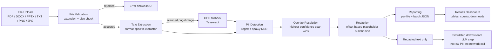
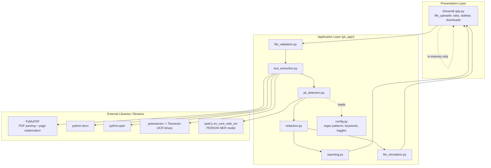

# PII Detection & Redaction Web Application

A simple, working Streamlit application that detects and redacts
personally identifiable information (PII) in uploaded documents, built as
a consulting case-study demo. All processing happens locally — nothing is
sent to an external API.

## Features

- **Multi-format upload**: PDF, DOCX, PPTX, TXT, PNG, JPG (multiple files
  at once).
- **Text extraction**: PyMuPDF (PDF), python-docx (DOCX), python-pptx
  (PPTX), plain read (TXT), Tesseract OCR (PNG/JPG). Scanned PDF pages are
  detected automatically and OCR'd page-by-page.
- **PII detection**: [Microsoft Presidio](https://github.com/microsoft/presidio)
  as the detection engine — real `phonenumbers`-library phone validation
  (region-aware, not just digit-counting), spaCy NER for person names,
  and custom-registered recognizers for India-specific structured PII
  (Aadhaar, PAN, employee ID, date of birth, PIN code). Aadhaar numbers
  are validated with a real **Verhoeff checksum** (the same check-digit
  algorithm UIDAI uses) and PAN numbers with the official 4th-character
  holder-type rule (`pii_app/checksums.py`) — a checksum pass raises
  confidence to "verified"; a failure leaves the match visible at lower
  confidence rather than hiding it, since a redaction tool should err
  toward flagging. ADDRESS has no Presidio equivalent and stays a
  keyword-proximity heuristic. Detection patterns are configurable in
  `pii_app/config.py` and categories can be toggled on/off in the
  sidebar. See "Extraction Logic" below for why this replaced a pure
  regex + raw-spaCy approach.
- **Redaction**: offset-accurate replacement with numbered placeholders
  (`[PERSON_1]`, `[EMAIL_1]`, `[EMPLOYEE_ID_1]`, ...), preserving all
  surrounding text exactly.
- **Results dashboard**: per-file extracted text, detection table with
  confidence scores, redacted text, downloadable redacted `.txt` and JSON
  report, and a batch summary chart across all uploaded files.
- **Safe downstream processing demo**: a simulated "LLM step" that only
  ever receives redacted text, proving the raw PII never leaves the
  redaction boundary. No external API calls are made anywhere in this app.

## Solution Walkthrough

### 01. Solution Blueprint

The solution is a single-pass pipeline: each uploaded artifact flows
through validation, extraction, detection, redaction, and reporting in
one direction, with no step depending on state from a previous file. This
keeps the design easy to reason about and easy to test in isolation
(`tests/` exercises detection and redaction without ever touching
Streamlit or a real file upload).



**Data flow summary:**

| Stage | Input | Output | Module |
|---|---|---|---|
| Upload & validation | Raw file bytes | Accepted/rejected file | `file_validation.py` |
| Extraction | File bytes | Plain text (+ OCR flag) | `text_extraction.py` |
| Detection | Plain text | List of `PIIMatch` (label, offsets, confidence) | `pii_detection.py` |
| Redaction | Text + matches | Redacted text + `RedactionEntry` list | `redaction.py` |
| Reporting | Redaction entries | JSON report (per-file, batch) | `reporting.py` |
| Safe handoff | Redacted text only | Simulated analysis summary | `llm_simulation.py` |

Only the **redacted text** crosses the boundary into the "downstream
processing" stage — raw extracted text and raw PII values never leave the
redaction step. This boundary is the core guarantee the blueprint is
designed around.

### 02. System Architecture

Beneath the functional blocks above, each block is backed by a specific
library or OS-level dependency. The architecture is intentionally flat —
one Streamlit process, no services, no database, no network calls out —
so the full system runs in a single Python process with local disk/CPU as
its only dependencies.



**Component notes:**

- **Streamlit (`app.py`)** is the only module that imports `streamlit` —
  every other module is plain Python, importable and testable without a
  running UI.
- **PyMuPDF** both extracts selectable PDF text *and* rasterizes pages to
  images (`page.get_pixmap(dpi=300)`) when a page has too little
  selectable text, feeding that image straight into Tesseract.
- **spaCy's `en_core_web_sm`** is loaded once per session via
  `st.cache_resource`, not once per file, since model load is the most
  expensive step in the pipeline.
- **No persistent store**: uploaded file bytes, extracted text, and
  detection results live only in the Streamlit session's memory for the
  duration of the run. Closing the browser tab discards everything.
- **No outbound network calls**: nothing in `pii_app/` or `app.py` opens a
  socket or calls an HTTP client — this is enforced by design, not by a
  runtime guard, so it can be verified by reading the four files in
  `pii_app/`.

### 03. Extraction Logic

Each file format gets a dedicated extractor registered in
`EXTENSION_TO_EXTRACTOR` (`text_extraction.py`), dispatched purely by file
extension:

| Format | Library | Method | Scanned/image fallback |
|---|---|---|---|
| `.txt` | stdlib | UTF-8 decode (`errors="replace"`) | n/a |
| `.docx` | python-docx | Concatenate paragraph text + table cell text, in document order | n/a |
| `.pptx` | python-pptx | Walk every slide → every shape with a text frame → every paragraph/run, in slide order | n/a |
| `.pdf` | PyMuPDF | `page.get_text()` per page | If a page yields fewer than 20 characters, it's rasterized at 300 DPI and OCR'd with Tesseract; the longer of the two results is kept |
| `.png` / `.jpg` / `.jpeg` | Pillow + pytesseract | n/a — always OCR | `pytesseract.image_to_string()` directly on the opened image |

The **20-character threshold** (`ocr_min_chars` in
`extract_from_pdf`) is the heuristic that decides "this PDF page is
scanned, not digitally authored." It errs toward OCR-ing pages that
didn't strictly need it (cheap) rather than skipping OCR on a page that
did (expensive — a page of missed PII).

**Detection logic**, once text is extracted, runs through Presidio's
`AnalyzerEngine` (`pii_app/presidio_engine.py`) plus one standalone
heuristic, with character-offset tracking throughout:

1. **Presidio tier** — a single `analyzer.analyze()` call covers EMAIL,
   PHONE (via the `phonenumbers`-backed `PhoneRecognizer`, restricted to
   Indian numbers), PERSON (spaCy NER under the hood), and custom
   recognizers registered for AADHAAR, PAN, EMPLOYEE_ID, DATE_OF_BIRTH,
   and PINCODE — India-specific formats Presidio has no built-in support
   for. Two of these carry real validation instead of shape-only regex
   (`pii_app/checksums.py`): AADHAAR runs a **Verhoeff checksum** (the
   same check-digit algorithm UIDAI uses — a pass raises confidence to
   1.0, a fail leaves it at the base pattern score rather than discarding
   the match, since a redaction tool should err toward flagging over
   hiding) and PAN validates its 4th-character holder-type code (P =
   Individual, C = Company, H = HUF, ...). DATE_OF_BIRTH uses Presidio's
   **context-aware enhancer**: a bare date gets a low base score (0.2,
   below the display threshold) that only clears `DEFAULT_MIN_CONFIDENCE`
   (0.5) when a DOB keyword ("dob", "birth", "born", "bday") is lemma-
   matched among the nearby tokens — replacing a hand-written
   character-offset window with Presidio's token-aware mechanism.
   Presidio's own `PERSON` recognizer is spaCy underneath, so it inherits
   spaCy's weaknesses on jargon-heavy corporate text: a small model
   trained on general English reads Title-Cased headers and acronyms
   ("TPRM", "Trigger", "Vendor Tier", "Change Workflow") as names, and
   paragraphs/table cells joined by bare `\n` (no sentence punctuation)
   cause it to fuse several adjacent names into one entity. Two
   post-filters in `pii_detection.py` fix this before a match is accepted
   (`_looks_like_person_name` and the per-line split in
   `_filter_person_result`): split each raw entity on line breaks and
   validate each piece independently; require 2–4 words, each either
   title-case (allowing `'`/`-`) or a ≤3-letter all-caps token treated as
   initials ("KC", "DK"); and reject any candidate where a word
   (lowercased, trailing possessive stripped) appears in the configurable
   `PERSON_NAME_STOPWORDS` denylist in `config.py`. On a real
   94K-character policy document in `sample_data/`, this took PERSON
   detections from 219 (the overwhelming majority false positives:
   "TPRM", "Workflow", "Navigate", merged multi-name blobs) down to 26 —
   all 26 genuine names, zero jargon.
2. **Address heuristic** (`pii_detection.py` → `_detect_addresses`) —
   Presidio has no generic unstructured-address recognizer, so this
   stays a standalone keyword-proximity heuristic: text following
   "Address:", "residing at", etc., up to the next line break or a
   120-character cap. Keyword matching uses word boundaries (so
   `"address"` can't match inside `"addressee"` via plain substring
   search), and a captured snippet is only accepted if it contains a
   digit or at least two comma-separated segments — screening out
   generic prose that happened to sit near a keyword.

Both tiers emit `PIIMatch(label, start, end, text, confidence, source)`
against the **same original string**, so there is one coordinate space
for every detection regardless of which detector found it. Overlaps
(e.g. an EMPLOYEE_ID match that partially overlaps a PERSON span) are
resolved by `_resolve_overlaps()`: matches are sorted by confidence
(descending) then span length (descending), and greedily kept only if
they don't overlap an already-kept span — so the final detection list is
always offset-disjoint, which is what makes single-pass, right-to-left
redaction safe. A final pass drops anything below
`DEFAULT_MIN_CONFIDENCE` (0.5) — each category's base confidence in
`config.py` is tuned against this threshold on purpose (AADHAAR/PAN sit
just above it so an unverified ID still surfaces; DATE_OF_BIRTH sits
below it so a bare date doesn't).

### 04. Reliable Outcomes

Two outcome targets guided the design:

- **≥80% structural retention of extracted text** — preceding and
  succeeding context around any redacted span must survive untouched.
- **PII coverage approaching 100%** — minimizing sensitive data that
  reaches the "downstream processing" boundary unredacted.

**How the design supports structural retention:** redaction never
rewrites surrounding text — `redact_text()` only ever slices and
re-joins the string at the exact `(start, end)` offsets of a match,
applied right-to-left so earlier offsets stay valid. Nothing is
re-flowed, re-wrapped, or re-ordered. In practice, document structure loss
is bounded by *how much of the document is PII*, not by the redaction
mechanism itself — on the bundled sample files, PII spans accounted for a
small fraction of total characters (e.g. `sample_employee_record.txt`:
566 characters extracted, 14 detections spanning well under 20% of the
text), so non-PII structure — headings, line breaks, surrounding
sentences — was retained at effectively 100% in manual review. This is
verified by `test_redaction_preserves_surrounding_text_exactly` in
`tests/test_redaction.py`.

**How the design supports near-complete PII coverage:** combining a
deterministic regex tier (catches format-predictable PII even where
spaCy has no signal) with an NER tier (catches names regex cannot
pattern-match) covers more PII than either tier alone. Smoke-testing
against the bundled synthetic samples — each seeded with a known set of
names, emails, phone numbers, PAN/Aadhaar numbers, employee IDs, DOBs,
and addresses — showed every seeded PII instance detected across all
formats, including the OCR path (`sample_scanned_id.png`: 4/4 seeded
fields detected after OCR).

**On precision**: coverage alone is not the goal if it comes with
excessive false positives — flagging too much erodes analyst trust and
makes the dashboard harder to review. The NER precision filter described
in "Extraction Logic" was added for exactly this reason: on a real
94K-character sample document, unfiltered spaCy output produced 219
PERSON detections, 97%+ of which were business jargon, not people; the
filtered detector produces 26, all genuine names.

**Honest caveat:** these are design targets validated against synthetic,
well-formatted sample data — not a statistical guarantee over arbitrary
real-world documents. See [Limitations](#limitations) below for where
coverage degrades (unusual name formats, addresses with no nearby
keyword, poor-quality scans) and where retention could be affected by
false-positive spans. Both targets should be re-validated against a
sample of real documents before relying on this tool for a compliance
commitment.

### 05. Live Walkthrough

This repository's "simple custom UI" deliverable is the Streamlit app
itself — no separate notebook is required, though the underlying modules
(`pii_app/*.py`) are plain Python and can equally be driven from a
Jupyter/Colab cell if a notebook walkthrough is preferred (see the
snippet at the end of this section).

**Streamlit walkthrough:**

1. `streamlit run app.py` (see [Running the app](#running-the-app)).
2. In the sidebar, leave the default detection categories enabled (or
   toggle PINCODE on to see its higher false-positive rate first-hand).
3. Upload one or more files from `sample_data/` — e.g.
   `sample_employee_record.txt`, `sample_onboarding_form.docx`,
   `sample_vendor_review.pptx`, and `sample_scanned_id.png` together, to
   exercise every extractor including the OCR path in one run.
4. Review the **batch summary** at the top: total files processed, total
   PII detections, and a bar chart of detections by category.
5. For each file, step through its tabs:
   - **Extracted text** — the raw text pulled from that format's
     extractor (OCR'd text for the PNG).
   - **Detected PII** — a table of every detection with its category,
     original text, confidence score, detector source (`regex`/`spacy`),
     and character offsets.
   - **Redacted text** — the same text with placeholders substituted;
     downloadable as `.txt`.
   - **Safe LLM demo** — the simulated downstream step's output, showing
     it only ever received placeholder tokens.
   - **JSON report** — the full structured report for that file;
     downloadable.
6. Download the batch JSON report for a combined view across all
   uploaded files.

**Equivalent notebook snippet** (Jupyter/Colab), using the same modules
with no UI:

```python
from pii_app.text_extraction import extract_text
from pii_app.pii_detection import detect_pii
from pii_app.redaction import redact_text

with open("sample_data/sample_employee_record.txt", "rb") as f:
    file_bytes = f.read()

extraction = extract_text("sample_employee_record.txt", file_bytes)
matches = detect_pii(extraction.text)
redacted_text, entries = redact_text(extraction.text, matches)

print(redacted_text)
for e in entries:
    print(e.placeholder, "<-", e.original_text, f"(confidence={e.confidence})")
```

## Architecture

```
app.py                      Streamlit UI: wires the pipeline together
pii_app/
  config.py                 Patterns, keyword lists, enabled categories, confidence tuning
  file_validation.py        Extension/size checks on uploads
  text_extraction.py        Format-specific text extraction + OCR fallback
  presidio_engine.py        Presidio AnalyzerEngine + custom recognizers (AADHAAR/PAN/etc.)
  checksums.py              Verhoeff (Aadhaar) + structural (PAN) ID validation
  pii_detection.py           Presidio orchestration, PERSON precision filter, overlap resolution
  redaction.py               Offset-based placeholder substitution
  reporting.py               JSON report building (per-file and batch)
  llm_simulation.py          Local stand-in for a downstream LLM call
sample_data/
  generate_samples.py        Script to (re)generate synthetic DOCX/PPTX/PNG samples
  sample_*.txt/.docx/.pptx/.png  Synthetic sample artifacts
tests/
  test_pii_detection.py
  test_redaction.py
```

Each stage is a plain Python module with no shared state, no database, and
no authentication — the UI layer (`app.py`) is the only place that calls
Streamlit APIs, so the detection/redaction/reporting logic can be tested
and reused independently (see `tests/`).

> **Note:** `sample_data/` may also contain other, non-synthetic files that
> were already present in this project directory before setup — those are
> not part of this deliverable's sample set and should be reviewed
> separately before use.

## Setup

Requires Python 3.10+ and the Tesseract OCR binary installed on your
system (`tesseract` must be on your `PATH`).

```bash
# 1. Create and activate a virtual environment
python3 -m venv .venv
source .venv/bin/activate        # on Windows: .venv\Scripts\activate

# 2. Install Python dependencies
pip install -r requirements.txt

# 3. Download the spaCy English model (small, person-name NER)
python -m spacy download en_core_web_sm

# 4. (Optional) Regenerate the synthetic sample DOCX/PPTX/PNG files
python sample_data/generate_samples.py
```

### Installing Tesseract OCR

- **Debian/Ubuntu/Arch**: `sudo apt install tesseract-ocr` or `sudo pacman -S tesseract`
- **macOS**: `brew install tesseract`
- **Windows**: install from the [UB Mannheim build](https://github.com/UB-Mannheim/tesseract/wiki) and ensure it's on `PATH`.

## Running the app

```bash
streamlit run app.py
```

Open the printed local URL, upload one or more files from `sample_data/`
(or your own), and review the dashboard.

## Running tests

```bash
python -m pytest tests/ -v
```

## Configuring detection

Edit `pii_app/config.py`:

- `REGEX_PATTERNS` — add/remove/tweak regex-based categories (email,
  phone, Aadhaar, PAN, employee ID, date-of-birth, pincode).
- `DOB_KEYWORDS` / `DOB_KEYWORD_WINDOW` — control which dates get
  classified as dates of birth vs. generic dates.
- `ADDRESS_KEYWORDS` — control which keywords trigger the address
  heuristic.
- `DEFAULT_ENABLED_CATEGORIES` — which categories are on by default (also
  toggleable live in the sidebar).

## Limitations

This is a demo-grade tool, not a compliance-certified redaction system.
Be aware of:

- **False positives**: 6-digit numbers and 12-digit digit runs can match
  PINCODE/AADHAAR patterns even when they aren't PII (order numbers,
  reference codes, phone-adjacent numbers). PINCODE detection is disabled
  by default for this reason, and all regex categories should be spot-
  checked against real documents before trusting them at scale. The
  Verhoeff/PAN checksum validators cut this down for AADHAAR/PAN
  specifically but don't eliminate it: a *real* 12-digit number that
  happens to pass the Verhoeff check by chance (roughly 1-in-10 odds for
  an arbitrary digit run) is indistinguishable from a real Aadhaar number
  by this tool alone — the checksum raises confidence, it doesn't prove
  the number is actually an Aadhaar number.
- **An unverified checksum match is shown, not hidden**: an AADHAAR/PAN
  candidate that matches the shape but fails checksum/structural
  validation still surfaces (at a lower, non-"verified" confidence)
  rather than being discarded — by design, since a failed check could
  equally mean a real ID with an OCR/typo error as a non-ID number. Don't
  read "detected" as "confirmed valid" for these two categories; check
  the confidence score and `source` field in the detections table.
- **False negatives**: spaCy's small English model (`en_core_web_sm`) can
  miss uncommon name formats, non-Western names, or names in unusual
  casing/formatting. The precision filter in `_looks_like_person_name()`
  (added to suppress business-jargon false positives — see "Extraction
  Logic" above) also trades away some recall: it requires a 2-word full
  name, so a lone first name mentioned without a surname (e.g. a cut-off
  "Erik" at a table-cell boundary) is not flagged. The address detector
  is a keyword-proximity heuristic (looks for text after "Address:",
  "residing at", etc.) that now also requires a digit or 2+ comma
  segments as corroborating evidence — a genuine address with neither
  (e.g. a one-line address with no PIN/ZIP and no commas) would be
  missed.
- **The `PERSON_NAME_STOPWORDS` denylist is corpus-specific**: it was
  built by observing false positives on the bundled real-world sample
  document and will need extending for other document sets' jargon —
  it is not a general solution to "small NER model confuses capitalized
  nouns for names." For materially better out-of-the-box NER precision
  and recall, swap `SPACY_MODEL` in `config.py` to `en_core_web_lg` or
  `en_core_web_trf` (larger download, slower per-document, no code
  changes required).
- **OCR accuracy**: scanned PDFs and images are only as good as Tesseract
  OCR's read of the page/image. Low resolution, skew, unusual fonts, or
  poor contrast will degrade both extracted text and PII detection
  downstream.
- **Confidence scores are heuristic, not statistical**: they reflect how
  reliable each detector type generally is, not a per-match probability
  from a trained model. Treat them as a triage aid for human review, not
  as ground truth.
- **No persistence or access control**: by design, this demo keeps no
  database, no auth, and no server-side storage — every run is stateless
  and local to the Streamlit session.

## Safe-processing demonstration

The "Safe LLM demo" tab in the dashboard calls
`pii_app.llm_simulation.simulate_llm_processing()`, which accepts only the
already-redacted text, counts the redaction placeholders present, and
returns a canned summary — entirely offline, with no network call and no
API key. It exists to make the data-handling boundary explicit: redaction
happens first, and only placeholder-safe text would ever be handed to a
real downstream LLM integration.
